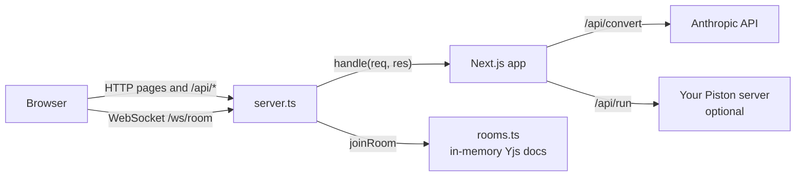

# Architecture

## One process, one port

Code Hub runs as a single Node.js process started from `server.ts`. That process does two jobs:

1. Serves the Next.js app (pages and API routes) through Next's request handler.
2. Accepts WebSocket connections on `/ws/<room>` for Live Codeshare.



Next.js doesn't host long-lived WebSockets in route handlers, so the app uses a Next.js custom server (the
"Custom Server" guide in the Next.js docs). The server also forwards
non-room WebSocket upgrades (Next's hot reload in development) to `app.getUpgradeHandler()`.

On a host that runs a long-lived Node process, that one process is the whole app. Serverless platforms such as
Vercel can't keep WebSocket connections open, so there the app runs on Vercel and the room logic runs separately as
the standalone relay in `relay/` (same `rooms.ts`), which the browser reaches through `NEXT_PUBLIC_REALTIME_URL`.
See 02-getting-started.md for both setups.

## What runs where

Most work happens in the browser. The server only does what the browser can't.

| Tool | Browser | Server |
| --- | --- | --- |
| Project to Script | Reads files, filters, hashes, builds tar.gz, writes the script | Nothing |
| Live Codeshare | Editor, Yjs document, cursors | Relays Yjs updates between people in a room |
| Run Code | Runs JavaScript, TypeScript (Web Worker) and Python (Pyodide) | Proxies other languages to Piston |
| AI Code Convert | Editor, streams the result into the output pane | Calls Claude, streams text back |
| Format Convert | Everything | Nothing |
| Image Convert | Everything (canvas, imagetracerjs) | Nothing |

## Folder map

```text
server.ts                      Custom server: Next.js + WebSocket upgrade routing, /api/realtime stats
relay/                         Realtime relay, its own small npm package
  rooms.ts                     Codeshare rooms (Yjs sync + awareness protocol), memory only
  server.ts                    Standalone relay server, for when the app runs on Vercel
render.yaml                    Render Blueprint that deploys relay/
src/
  app/
    layout.tsx                 Root HTML, fonts, metadata
    globals.css                Tailwind v4, colour tokens, shared component classes (.card, .btn-primary, ...)
    (tools)/                   Route group: every page here gets the dashboard layout
      layout.tsx               Wraps pages in DashboardShell
      page.tsx                 / -> Project to Script
      codeshare/page.tsx       Lobby: new room / join room
      codeshare/[room]/page.tsx  A room
      run/page.tsx             Run Code
      convert/ai/page.tsx      AI Code Convert
      convert/format/page.tsx  Format Convert
      convert/image/page.tsx   PNG / SVG Convert
    api/
      run/route.ts             POST: run code on Piston
      convert/route.ts         POST: AI conversion, streamed
      status/route.ts          GET: which optional keys are configured
  components/
    DashboardShell.tsx         Sidebar, top bar, mobile menu
    CodeEditor.tsx             CodeMirror 6 wrapper (themes, languages, optional collaboration)
    RunPanel.tsx               Run button, stdin, output console
    LanguageSelect.tsx         Language dropdown grouped by where it runs
    CodeshareRoom.tsx          The live room (Yjs + WebSocket provider)
    CodeshareRoomClient.tsx    Loads CodeshareRoom in the browser only
    Packer.tsx                 Project to Script page
    PageHeader.tsx             Page title + intro
  lib/
    languages.ts               Language list: labels, Piston names, highlighting, samples
    runner.ts                  In-browser code runners and the server fallback
    useServerStatus.ts         Hook for /api/status
    codeshare.ts               Room ids, colours, the saved display name
    sources.ts                 Reading a picked folder, a dropped folder or a .zip
    convert/formats.ts         Format converters
    pack/                      Project to Script engine (see 04-project-to-script.md)
  types/imagetracerjs.d.ts     Types for the image tracer
scripts/
  selftest.ts                  End-to-end test of generated scripts
  share.ts                     Builds code-hub-share/ (setup scripts for this repo)
  read-project.ts              Node version of "read a folder", shared by the two scripts above
```

## Key decisions

| Decision | Why |
| --- | --- |
| No storage anywhere | Product requirement. Rooms are memory-only; files never leave the browser. |
| Custom server instead of `next start` | Live Codeshare needs WebSockets on the same origin and port. |
| Yjs (CRDT) for codeshare | Two people typing at once merge cleanly; cursors come free through "awareness". |
| Own room relay instead of `@y/websocket-server` | Its in-memory mode keeps documents after everyone leaves. Ours deletes them. |
| Browser runners for JS, TS, Python | Free and instant, no server. The public Piston API has been whitelist-only since 15 Feb 2026. |
| CodeMirror 6, not Monaco | Much smaller, works on mobile, has a maintained Yjs binding. |
| `"type": "module"` in package.json | Makes `tsx server.ts` load the ESM build of Yjs once. In CommonJS mode it loaded two copies. |
| Next.js 16 with partial prerendering | Static pages prerender; the room page streams its dynamic part behind Suspense. See 03-dashboard-ui.md. |

## Tech stack

| Layer | Library |
| --- | --- |
| Framework | Next.js 16 (App Router), React 19, TypeScript |
| Styling | Tailwind CSS v4 |
| Editor | CodeMirror 6, `@codemirror/lang-*`, `@codemirror/theme-one-dark` |
| Realtime | `ws` (server), `yjs`, `y-protocols`, `y-websocket` (client provider), `y-codemirror.next` |
| Runners | Web Workers, `sucrase` (TS to JS), Pyodide 314.0.7 from jsDelivr |
| AI | `@anthropic-ai/sdk`, model `claude-opus-5-5` |
| Converters | `yaml`, `imagetracerjs`, `fflate` (gzip/zip), `ignore` (.gitignore rules) |
| Server runtime | `tsx` (runs `server.ts` without a build step) |
