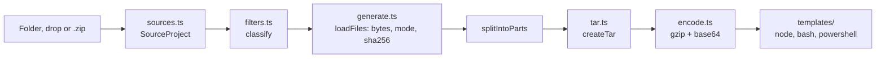

# Project to Script

Turns a project folder (or a .zip of it) into one script. Run the script on another machine and it recreates the
exact same files, verified with SHA-256. Everything happens in the browser.

## Pipeline

| Step | File | What happens |
| --- | --- | --- |
| Read | `src/lib/sources.ts` | Turns the input into a `SourceProject`: file list with lazy `read()`, empty folders, skipped folders |
| Classify | `src/lib/pack/filters.ts` | Marks each file included or excluded, with a reason |
| Load | `generate.ts` `loadFiles` | Reads bytes, guesses the Unix mode, computes SHA-256 |
| Split | `generate.ts` `splitIntoParts` | Optional: groups files into parts of a target size |
| Pack | `tar.ts` | Writes a POSIX tar archive |
| Encode | `encode.ts` | gzip level 9, then base64 wrapped at 120 characters |
| Render | `templates/*.ts` | Wraps the payload in an extractor script |

## Reading the input (`sources.ts`)

Three entry points, all returning a `SourceProject`:

- **`fromFolderInput`**: from `<input type="file" webkitdirectory>`. The browser lists every file, `node_modules`
  included, so skipped folders are dropped by path before any bytes are read.
- **`fromDrop`**: from drag and drop. It walks `FileSystemEntry` objects and never enters skipped folders, so a
  dropped `node_modules` costs nothing. It must run synchronously inside the drop handler, because the browser
  clears `DataTransfer` afterwards. A single dropped `.zip` goes to `fromZip`.
- **`fromZip`**: unzips with fflate in a worker, skipping `__MACOSX/` and skipped folders. If every entry sits under
  one top folder, that folder is stripped and becomes the project name.

Bytes are read lazily (`read: () => Promise<Uint8Array>`), so classifying 10,000 files reads nothing but the
`.gitignore` files.

## Deciding what to include (`filters.ts`)

| Rule | Examples | Can the user include it? |
| --- | --- | --- |
| `SKIP_DIRS`, anywhere in the tree | `node_modules`, `.git`, `.next`, `.expo`, `Pods`, `.gradle`, `__pycache__`, `.venv` | No, never read |
| `SKIP_PATHS`, exact paths only | `android/build`, `android/app/build`, `ios/build` | No |
| Junk files | `.DS_Store`, `Thumbs.db`, `desktop.ini` | Yes |
| Secrets | `.env*` (except `.env.example`, `.sample`, `.template`), `*.pem`, `*.key`, `*.keystore`, `google-services.json` | Yes, per file |
| `.gitignore` matches | Whatever the project ignores | Yes, per file, or switch the rule off |

`.gitignore` handling (`loadGitignore`) applies every `.gitignore` in the tree, shallowest first, so a nested file
can re-include (`!pattern`) what a parent excluded. The `ignore` package does the pattern matching.

Browsers don't expose Unix permissions, so `guessMode` marks a file executable (`0755`) when it starts with `#!`,
is named `gradlew` or `mvnw`, ends in `.sh` or `.command`, or is a husky hook. Everything else is `0644`.

## The archive (`tar.ts`)

A small POSIX tar writer. Paths longer than 100 bytes or containing non-ASCII characters get a pax `path` record,
which GNU tar, bsdtar (macOS, Windows `tar.exe`) and our own Node extractor all read. Empty folders are written as
directory entries in the first part.

## The scripts (`templates/`)

All three formats carry the same gzipped tar as base64, plus the SHA-256 of the payload and of every file.

| Format | Runs on | Needs | Extras |
| --- | --- | --- | --- |
| `node.ts` (`.mjs`) | macOS, Windows, Linux, Git Bash | Node 18+ | `--dry-run`, `--force`, `--prune`, update mode |
| `bash.ts` (`.sh`) | macOS, Linux, Git Bash | tar, base64 or openssl, sha256sum or shasum | `FORCE=1` |
| `powershell.ts` (`.ps1`) | Windows 10 1803+ | the built-in `tar.exe` | `-Force` |

What every script does, in order:

1. **Checks the payload hash before writing anything.** A paste cut off halfway fails here with "This script is
   damaged".
2. **Refuses a folder that holds something else**, unless forced. A folder is fine if it is empty (ignoring the
   script itself and OS junk) or if its manifest names the same project.
3. **Unpacks.** The Node script parses tar itself, rejects absolute paths and `..`, sets file modes outside Windows,
   and restores modification times.
4. **Verifies every file** against its SHA-256 from the upload.
5. **Writes a manifest**, `.code-to-script.json`: project name, files written, parts done.

Details worth knowing:

- **The Node script's payload sits in a function at the bottom** (`function payload()`), so the readable code
  stays at the top. Function declarations are hoisted, so it can be called before it appears.
- **Update and prune (Node only).** On a re-run the script compares each file and reports created, updated and
  unchanged. With `--prune` it deletes files that an earlier version recorded in the manifest but this version no
  longer has. It only touches files that scripts wrote.
- **The bash script survives CRLF.** Every code line ends in ` #`. If a Windows editor saves it with CRLF line endings,
  the stray `\r` lands in a comment instead of breaking the command.
- **PowerShell and non-ASCII.** Windows PowerShell 5.1 reads a `.ps1` without a BOM in the ANSI code page. Any
  non-ASCII string (file names, project name) is embedded as base64 UTF-8 and decoded at run time.

## Splitting into parts

`splitIntoParts` walks files in path order and starts a new part when the estimated size passes the target. The
estimate is per-file deflate size plus overhead per file. Path order keeps related files together, which compresses
better. A file bigger than the target gets a part of its own. Parts are independent and can run in any order.

## The page (`src/components/Packer.tsx`)

State: the loaded `SourceProject`, its classification, per-file `overrides` (user ticks), formats, split size, and
the generated scripts. Clicking Generate reads and hashes the included files (with a progress message), then calls
`generateScripts`. Results offer Copy and Download per script, plus "how to run" steps for the chosen format.

## Where to change things

| You want to | Edit |
| --- | --- |
| Skip another build folder | `SKIP_DIRS` or `SKIP_PATHS` in `filters.ts` |
| Flag another secret file type | `SECRET_PATTERNS` in `filters.ts` |
| Suggest another "next step" command | `guessNextSteps` in `generate.ts` |
| Change what the scripts print or check | `src/lib/pack/templates/` (then run `npm run selftest`) |
