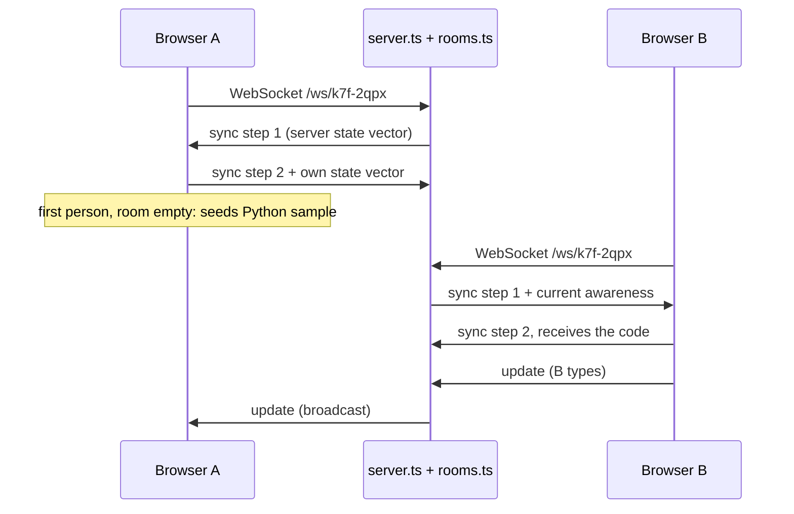

# Live Codeshare

People open the same room link and edit one document together, with live cursors, a shared language setting and a
Run button. Rooms live only in server memory.

## How it fits together

| Piece | File | Role |
| --- | --- | --- |
| Lobby | `src/app/(tools)/codeshare/page.tsx` | "New room" makes a random id; "Join" accepts a code or a pasted link |
| Room route | `src/app/(tools)/codeshare/[room]/page.tsx` | Validates the id, renders the room behind Suspense |
| Browser-only loader | `src/components/CodeshareRoomClient.tsx` | `next/dynamic` with `ssr: false` |
| Room UI | `src/components/CodeshareRoom.tsx` | Yjs document, WebSocket provider, editor binding, people, run panel |
| Relay | `src/server/rooms.ts` | Keeps one Yjs document per room in memory and relays updates |
| Upgrade routing | `server.ts` | Sends `/ws/<room>` to the relay, other upgrades to Next.js |

Room ids match `^[a-z0-9-]{3,40}$`, enforced on both sides (`src/lib/codeshare.ts` and `src/server/rooms.ts`).
New ids look like `k7f-2qpx`, built from an alphabet without look-alike characters (no `0/o`, `1/l/i`).

## Yjs in one paragraph

[Yjs](https://docs.yjs.dev) is a CRDT: each browser holds a copy of the document, edits become small binary
updates, and updates merge in any order with the same result. The server needs no knowledge of the content. It
applies updates to its own copy (so latecomers get the current state) and forwards them. Cursors and names travel
separately through **awareness**, a lightweight presence channel that isn't part of the document.

The room's document holds:

- `Y.Text "code"`: the editor contents.
- `Y.Map "meta"`: `language`, the shared language id.

## Connection flow

## The relay (`src/server/rooms.ts`)

It speaks the same wire protocol as `y-websocket`, so the browser uses the stock `WebsocketProvider`. Each message
starts with a type: `0` = sync, `1` = awareness.

- **`joinRoom(name, ws)`** creates the room on first use, registers the socket, sends sync step 1 and the current
  awareness states.
- **Incoming sync messages** go through `syncProtocol.readSyncMessage`, which applies updates to the room's document
  and writes any reply.
- **Document updates** (`doc.on("update")`) are broadcast to every socket in the room.
- **Awareness updates** are broadcast too. The relay records which awareness client ids belong to each socket, so it
  can remove that person's cursor when the socket closes.
- **Keep-alive:** a ping every 30 seconds; a socket that missed the previous pong is terminated.
- **Cleanup:** when the last socket leaves, a 60-second timer starts. If nobody rejoins, the document is destroyed
  and the room deleted. The grace period lets a page refresh reconnect without losing the code.

Limits: at most 500 rooms (new ones are refused with close code 1013), and 2 MB per WebSocket message
(`maxPayload` in `server.ts`).

`roomStats()` feeds `GET /api/realtime`, which counts rooms with at least one person.

## The room page (`src/components/CodeshareRoom.tsx`)

On mount, one effect:

1. Creates a `Y.Doc` and a `WebsocketProvider` with `connect: false`, so listeners attach before the first event.
2. Picks a colour and a display name (saved name from `localStorage`, or "Guest 123") and publishes them through
   awareness.
3. Builds the CodeMirror binding: `yCollab(text, awareness, { undoManager })`. Undo only undoes your own edits.
4. Listens to `status` (connected / connecting / disconnected), `sync` (seeds an empty room with the Python sample),
   the `meta` map (language changes) and awareness (the people list).
5. Calls `provider.connect()`.

The cleanup destroys the provider and document, which closes the socket. The server then removes this person's
cursor.

**Changing the language** writes `meta.language` for everyone. If the editor still holds an untouched sample, it is
swapped for the new language's sample; real code is never replaced.

**Running code** reads the shared text at the moment you click Run and runs it locally (see 06-run-code.md). Output
isn't shared: each person runs it themselves.

## Why the room renders only in the browser

`server.ts` imports Yjs for the relay. If Next.js also server-rendered `CodeshareRoom`, its server bundle would load a
second copy of Yjs in the same process and log "Yjs was already imported". That breaks Yjs's internal type checks
when both copies touch the same objects. The room can't do anything useful on the server anyway, so
`CodeshareRoomClient` loads it with `ssr: false`.

## Extending

| You want to | How |
| --- | --- |
| Share another setting (theme, stdin) | Add a key to the `meta` map, observe it like `language` |
| Show who is typing where | Awareness already carries cursors; `y-codemirror.next` renders them |
| Keep rooms alive longer when empty | `EMPTY_ROOM_TTL_MS` in `rooms.ts` (memory only; still no storage) |
| Run on several server instances | Needs a shared relay (for example Redis pub/sub between processes); not built |
